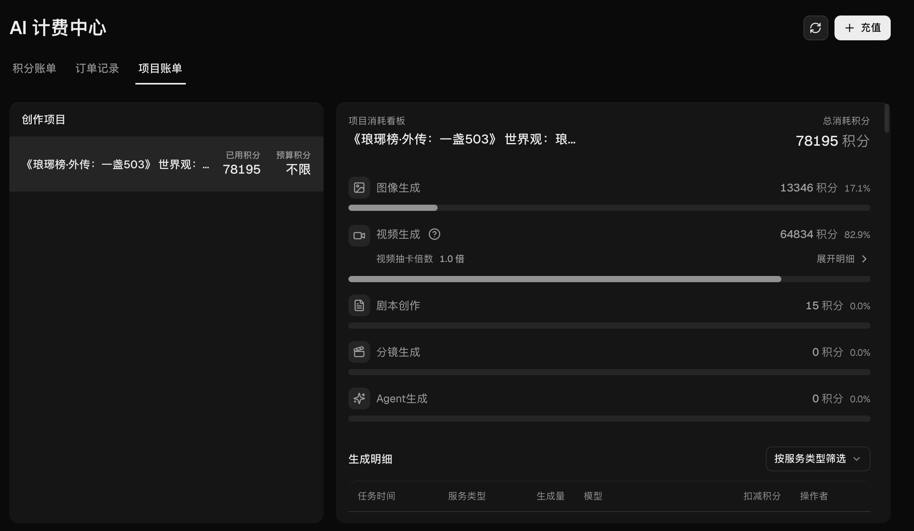

# 琅琊榜世界观连续短剧创作

**《琅琊榜·外传：一盏503》** —— 使用 Canvas 完成的三集连续短剧，植入实体商品**吉普号 503 普洱茶**。
更新日期：2026-10-26。

---

## 三集作品

[▶ 三集在线观看](https://github.com/langya-503/langya-503/issues/1) — 打开后点击视频播放按钮即可观看。
在线播放为轻量预览版；下表提供交付原片下载。

视频按剧集存放于 `videos/一盏503/`。

| 剧集 | 分集 | 成片时长 | 视频 |
|---|---|---:|---|
| 一盏503 | 第1集 南茶北渡 | 02:32.57 | [原片下载](https://github.com/langya-503/langya-503/blob/main/videos/%E4%B8%80%E7%9B%8A503/%E7%AC%AC1%E9%9B%86-%E5%8D%97%E8%8C%B6%E5%8C%97%E6%B8%A1.mp4) |
| 一盏503 | 第2集 茶中藏锋 | 02:06.53 | [原片下载](https://github.com/langya-503/langya-503/blob/main/videos/%E4%B8%80%E7%9B%8A503/%E7%AC%AC2%E9%9B%86-%E8%8C%B6%E4%B8%AD%E8%97%8F%E9%94%8B.mp4) |
| 一盏503 | 第3集 一盏归心 | 02:16.49 | [原片下载](https://github.com/langya-503/langya-503/blob/main/videos/%E4%B8%80%E7%9B%8A503/%E7%AC%AC3%E9%9B%86-%E4%B8%80%E7%9B%8A%E5%BD%92%E5%BF%83.mp4) |

三集合计约 **6 分 56 秒**，单集落在 2–3 分钟区间。三集已完成字幕、人物与地点首次出场标注、画面修整（清除 28 处资产参考图泄露）。

---

## 创作设计

- **一盏503：茶里藏着兵符，也藏着十二年。**
  全剧只虚构了一个设定——赤焰案的兵符信物，当年被藏进了一饼云南穆府进贡的普洱里。霓凰掌云南穆府（普洱即云南产物），茶饼紧压、棉纸包裹、火漆封印（藏得住东西，也经得起三千里颠簸），全金陵的眼睛都盯着夺嫡（没人会去查一饼茶）。**把这饼茶抽掉，三段冲突全部不成立。**
- **产品卖点即剧情细节。**
  三山拼配（易武 / 勐海 / 临沧）、米汤感、木质香、无堆味、十二年陈化——全部来自 503 的真实产品资料，由角色在品鉴与烹茶时说出，不喊口号。
- **商品属性直接决定策略设计。**
  第三集「同一批茶分送太子、誉王两府」的计谋，只有在**可分割、可复制、有独立价值**的茶上才成立；换成一件孤品，此计在物理上无法实现。
- **品牌气质即人物人设。**
  苏哲「理性、克制、算无遗策」的谋士形象，与 503「理性普洱」的品牌理念互为镜像。
- **制作策略。**
  剧本在本地写完整后一次性灌入平台，LLM 只做忠实转换；66 个镜头全部一次生成，绝不抽卡；所有画面缺陷在本地 ffmpeg 修复，后期阶段 0 积分。

---

## 团队成员与分工

| 成员 | 身份 | 分工 |
|---|---|---|
| 宋晋东 | 独立创作者 | 创意设定、剧本、程序化生产、后期制作、成本控制 |

---

## 积分统计

总额度 **100,000 积分**；本项目累计消耗 **78,195 积分**（78.195%），扣除本项目后的额度差额 **21,805 积分**。

| 类别 | 消耗 | 说明 |
|---|---:|---|
| 视频生成 | 64,834 | Kling V3 · 720p · 415.5 秒 |
| 图片生成 | 13,346 | GPT Image 2.5 Flare · 66 张分镜图 + 资产图 + 测试 |
| 剧本处理 | 15 | — |
| **合计** | **78,195** | |

官方成本指标（平台账单接口出具）：**抽卡倍数 1.0 · 积分利用率 100%**。
单位时长成本约 **11,288 积分 / 分钟**；本地分集与后期处理未新增 Canvas 积分。

2026-10-26 核对 Canvas 项目页面。以上为整个项目的累计消耗，包含资产、测试与生成等开支。21,805 是总额度扣除本项目的差额，不冒充全账户实时余额。详见[积分与交付统计](docs/05-cost-and-delivery.md)。

---

## 创作资料

- [课题目标与作品定位](docs/01-brief.md)
- [项目创作与制作流程](docs/02-process.md)
- [故事与分集设计](docs/03-script.md)
- [分镜与视听设计](docs/04-storyboard.md)
- [积分与交付统计](docs/05-cost-and-delivery.md)
- [三集文件清单与 SHA-256](videos/manifest.json)

---

本项目为《琅琊榜》世界观衍生创作，吉普号 503 普洱茶为实体商品植入，「兵符藏于茶」为本剧原创设定。
